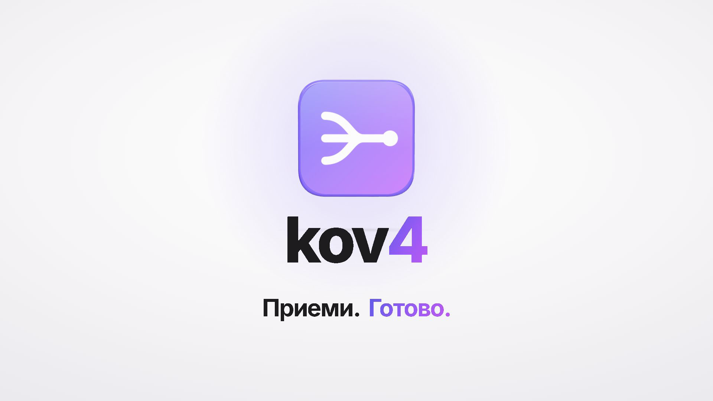
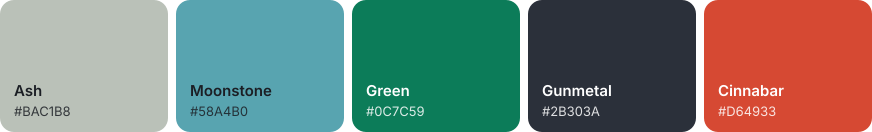
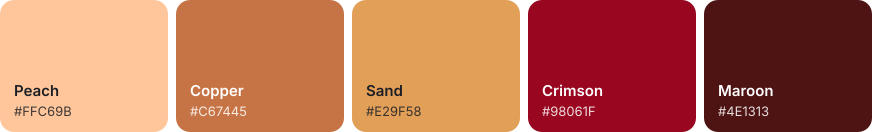

# kov4 website

Marketing site for kov4: delivery platform integration for merchants (Glovo, Wolt, Bolt Food and comparable marketplaces).

**Live:** https://kov4-website.vercel.app

[](media/kov4-explainer.mp4)

React 19 and Tailwind CSS 4 on Next.js 16 (App Router, Cache Components). The homepage and privacy page are prerendered as static HTML; the only server code is the contact form endpoint.

## Run it

```bash
npm install
npm run dev        # http://localhost:3000
npm run build && npm start
```

## Configuration

Copy `.env.example` to `.env.local` and fill in what you need. `.env.local` is git-ignored.

| Variable | Purpose |
| --- | --- |
| `NEXT_PUBLIC_BRAND_NAME` | Brand name shown across the site (default `kov4`). |
| `NEXT_PUBLIC_SITE_URL` | Canonical URL, used for metadata. |
| `NEXT_PUBLIC_CONTACT_EMAIL` | Public contact address and the form's email fallback. |
| `NEXT_PUBLIC_SHOW_SAMPLE_PROOF` | `true` shows the **fictional** sample clients. See below. |
| `LEAD_PROVIDER` | Where form submissions go: `webhook`, `resend` or `file`. |

### Sample clients (fictional)

`src/content/sample-proof.ts` contains five invented restaurant brands (Kvartal Kitchen, Forno Sette, Odd Bun, Kora Bakehouse, Wok Theory), three case studies and one quote. They exist only to preview the site with social proof.

- They render only when `NEXT_PUBLIC_SHOW_SAMPLE_PROOF=true`. The local `.env.local` sets this; nothing else does.
- With the flag off, the hero shows a "pilot partners" line instead and the case-study section disappears.
- **Before going live**, either leave the flag off or replace the entries with real clients who have agreed to be named. Do not set the flag in your hosting provider's production environment while the content is fictional.

The flag is read at build time (`NEXT_PUBLIC_*`), so rebuild after changing it.

### Contact form delivery

The form validates in the browser and again on the server (`src/lib/leads/schema.ts`), with a honeypot field, a minimum fill time and a per-instance rate limit as spam protection.

Submissions go through `src/lib/leads/deliver.ts`. Pick one provider:

**Webhook** (Make, Zapier, n8n, a Slack workflow, your CRM):

```
LEAD_PROVIDER=webhook
LEAD_WEBHOOK_URL=https://hook.example.com/...
LEAD_WEBHOOK_SECRET=optional-shared-secret   # adds x-signature-256: sha256=<hmac>
```

**Email via [Resend](https://resend.com)** (verify your sending domain in Resend first):

```
LEAD_PROVIDER=resend
RESEND_API_KEY=re_...
LEAD_EMAIL_TO=hello@kov4.com
LEAD_EMAIL_FROM=kov4 website <forms@kov4.com>
```

**Local file** (development only; writes `.leads/leads.jsonl`):

```
LEAD_PROVIDER=file
```

If no provider is configured, or delivery fails, the API returns an error, the visitor sees a clear message that nothing was sent, and the form offers a pre-written email to `NEXT_PUBLIC_CONTACT_EMAIL`. Submissions are never silently dropped.

Never commit API keys. Set them as environment variables in your hosting provider.

### Photography and type

- Photos live in `src/assets/photos/` and are registered, with alt text and credits, in `src/content/photos.ts`. They're served through `next/image` (AVIF/WebP, blur-up placeholders).
- All current photos are from [Unsplash](https://unsplash.com/license): free for commercial use, no permission needed. Photographers are credited in the footer. The three photos used only by the fictional case studies (`sample: true`) are credited only when the sample flag is on.
- To swap a photo, replace the file and keep the same name, or add a new import in `photos.ts`. Each frame chooses its crop with a `position` value, so check the framing after swapping.
- **Intro and hero animation.** The homepage opens with a short intro (`src/components/intro.tsx`): Glovo, Wolt and Bolt Food send orders into the kov4 vortex, which passes them to restaurant terminals that print receipts. It plays once per browser tab, never for visitors who ask for reduced motion, and can be skipped with a click or Esc. Add `?intro` to the URL to replay it. The hero scene (`src/components/order-stage.tsx`) then keeps sending random example orders (from `src/content/orders.ts`) to a POS terminal and printing a receipt for each.
- Order screens, tickets, tables and logs on the page are drawn in code, not screenshots. They use example data and are labelled as illustrations; keep it that way until you have a real product screen to show.
- Logo: the KOV4 vortex emblem, cut out of the original artwork onto a transparent background (the "SLOGAN HERE" placeholder from the artwork is left out). PNGs live in `src/assets/brand/`: `kov4-emblem.png` (the full stacked logo, used in the footer), `kov4-mark.png` (the vortex alone) and `kov4-wordmark.png` (the KOV4 lettering). The header pairs the mark with the wordmark. The favicon and home-screen icon are `src/app/icon.png` and `src/app/apple-icon.png`. Exports for social profiles and print are in `docs/brand/`.
- Type: Inter with its optical-size axis (headlines automatically use the Display cut) and IBM Plex Mono for the printed tickets. Both support Cyrillic for a Bulgarian version.

### Colour palettes

**Site palette** (in use): [coolors.co/bac1b8-58a4b0-0c7c59-2b303a-d64933](https://coolors.co/bac1b8-58a4b0-0c7c59-2b303a-d64933)



Defined as tokens in `src/app/globals.css` (`ink`, `mist`, `brand`, `sky`, `signal`, `night` and their shades).

**Warm palette**: [coolors.co/ffc69b-c67445-e29f58-98061f-4e1313](https://coolors.co/ffc69b-c67445-e29f58-98061f-4e1313)



| Token | Hex |
| --- | --- |
| `warm-peach` | `#ffc69b` |
| `warm-copper` | `#c67445` |
| `warm-sand` | `#e29f58` |
| `warm-crimson` | `#98061f` |
| `warm-maroon` | `#4e1313` |

Imported as Tailwind tokens in `src/app/globals.css`, so utilities such as `bg-warm-copper` or `text-warm-maroon` work anywhere. The live pages don't use it yet.

### Explainer video

[`media/kov4-explainer.mp4`](media/kov4-explainer.mp4): about 84 seconds, 1920×1080, with a Bulgarian voiceover.

Its full source is in [`video/`](video/): a separate [Remotion](https://www.remotion.dev) project (React Three Fiber scenes), the voiceover takes, the music, and the Python tools that build the audio and timing. [`video/README.md`](video/README.md) covers the pipeline and common edits. To preview or re-render it:

```bash
cd video
npm install
npm run studio     # live preview in the browser
npm run render     # writes out/kov4-explainer.mp4
```

Changing the voiceover or timing also needs Python with `video/tools/requirements.txt` installed and `ffmpeg` on your PATH. After a new render, copy `video/out/kov4-explainer.mp4` over `media/kov4-explainer.mp4` to update the copy linked here.

`media/`, `docs/` and `video/` aren't part of the site build: `.vercelignore` keeps them out of deployments, and `tsconfig.json` and ESLint skip `video/`.

## Deployment

Hosted on [Vercel](https://vercel.com), connected to this repository: every push to `main` deploys to production, and other branches get preview URLs.

Set environment variables in the Vercel project settings, not in the repository. `NEXT_PUBLIC_SITE_URL` is set to the live URL. Until a lead provider (`LEAD_PROVIDER` plus its keys, see above) is configured there, the contact form tells visitors nothing was sent and offers the pre-written email instead.

## Before launch

- [ ] Real contact email and domain in the environment variables.
- [ ] A lead provider configured and a test submission received.
- [ ] `NEXT_PUBLIC_SHOW_SAMPLE_PROOF` off, or the sample content replaced with real, approved clients.
- [ ] Privacy notice (`src/app/privacy/page.tsx`) reviewed, with your registered company name, address and ЕИК added.
- [ ] Confirm the claims match how you operate: the assessment is free, you work in Bulgarian and English, and the "30-minute call" in the contact section.
- [ ] Consider replacing the Unsplash photos with your own shoot over time (your team, and client kitchens with their permission).

## Where things live

| Path | What |
| --- | --- |
| `src/app/page.tsx` | Homepage section order |
| `src/components/hero.tsx`, `pos-console.tsx` | Hero photograph with the illustrated POS order queue |
| `src/components/showcase.tsx`, `order-flow.tsx` | "Three apps. One ticket." section and its illustration (plays once when scrolled into view) |
| `src/components/features.tsx` | "What a connected setup can do" tiles (illustrations with example data) |
| `src/components/solutions.tsx`, `rail.tsx` | Industry cards in a horizontal carousel |
| `src/components/integrations.tsx` | Hub diagram and the technical detail for IT teams |
| `src/components/market.tsx` | Full-width Sofia photograph section |
| `src/content/site.ts` | Brand, navigation, channel list |
| `src/content/photos.ts`, `src/assets/photos/` | Photography, alt text and credits |
| `src/content/sample-proof.ts` | Fictional sample clients (flagged) |
| `src/lib/leads/` | Form schema, validation and delivery adapters |
| `src/app/api/contact/route.ts` | Form endpoint |
| `src/app/globals.css` | Colour tokens and type scale |
| `media/` | Explainer video and its thumbnail |
| `video/` | Editable source of the explainer video (Remotion project) |
| `docs/` | Palette swatches used in this README, and the [website content plan](docs/website-content-plan.md) (what the site should say to earn trust and convert) |

## Contributors

- [@blackalex610](https://github.com/blackalex610)
- [@Kova4ev](https://github.com/Kova4ev)
